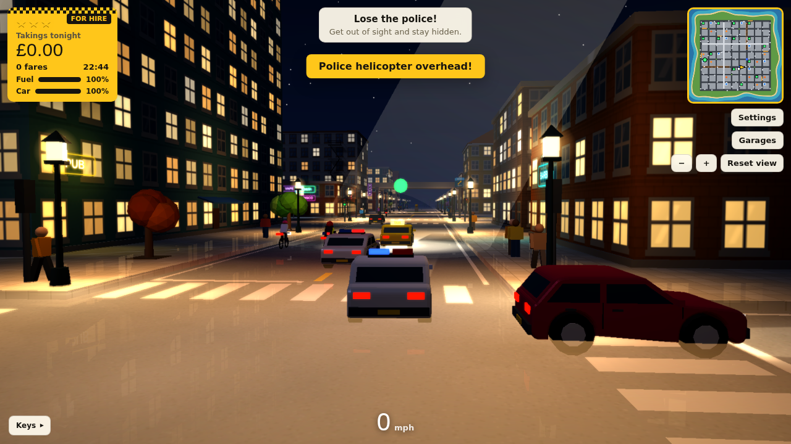
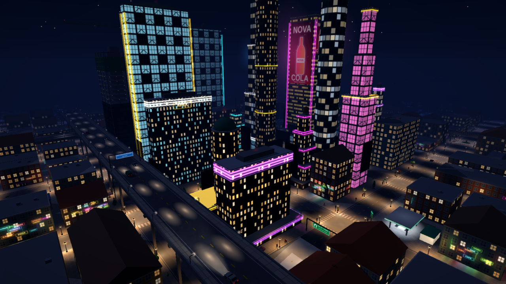
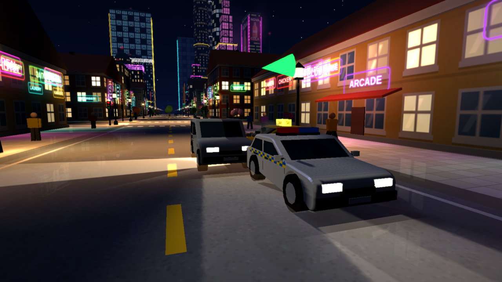
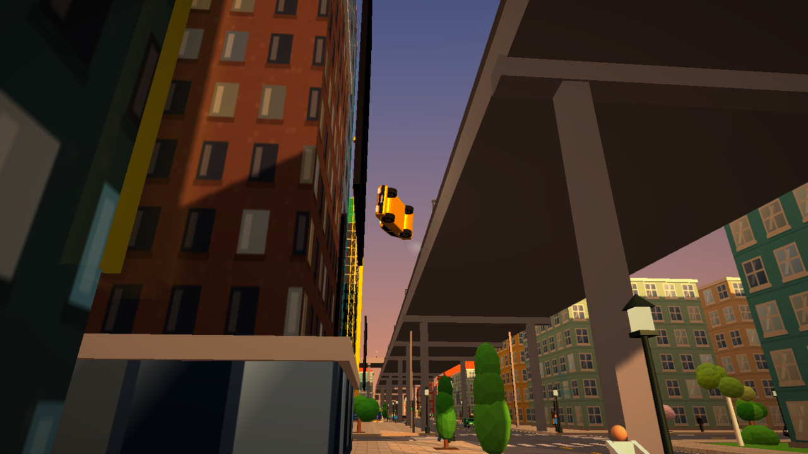
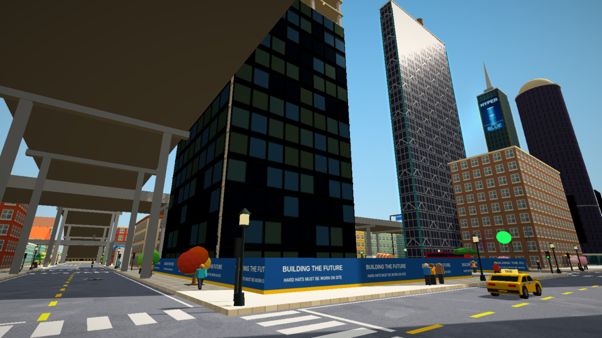

# Night Shift Taxi 🚕

**[▶ Play in your browser](https://sebszz.github.io/taxi-game/)**: no download, works on PC, Mac, phones, tablets and Meta Quest (VR).

Drive a yellow cab through a living city, from sunny afternoons to neon-soaked nights. Pick up passengers, get them where they're going fast for bigger tips, and try to stay out of trouble. Or don't.

## What you can do

- **Pick up and drop off passengers**: green beams for pickups, orange for drop-offs. Faster trips earn bigger tips. Some fares wait up on the overpass.
- **Explore a whole city**: downtown skyscrapers with giant digital billboards, a Times Plaza crossroads, tunnels, two elevated expressways, roundabouts, a beach lined with palm trees, rough streets, restaurants and a building site with working tower cranes.
- **Day and night**: the sun sets and rises as you play, or pick your own time of day in Settings.
- **Get chased by the police**: speed past them, run a red light or hit someone and you'll earn up to 3 wanted stars. Patrol cars, vans, motorbikes, roadblocks and a helicopter with a searchlight come after you, with chase music and police radio chatter. Lose them by getting out of sight, or hide your cab in a garage.
- **Crash into things**: knock over lamp posts, traffic lights, trees and palms, shove cars into spins, flatten tents, scatter cones, sofas and bin bags. Walls crack and throw dust, hard hits throw sparks. Your cab dents, smokes and slows down as it takes damage.
- **Keep the cab running**: fill up at petrol stations and repair at one of 10 garages, each with its own prices. Run out of money and you'll go into debt.
- **Mind the edges**: drive off the overpass or into the sea and it's game over, with a replay.
- **Play in VR** on a Meta Quest: sit in the driver's seat, steer with the thumbstick or grab the wheel with both hands, and check your mirrors.

## Controls

| Keyboard | Action |
|---|---|
| W A S D or arrow keys | Drive |
| Space | Handbrake |
| C | Change camera: behind, driver's seat, bonnet |
| F | Fill up or repair |
| G | Garages and repair prices |
| O | Settings |
| P or Esc | Pause |

**Phones and tablets:** use the on-screen arrow buttons.

**VR (Meta Quest):** open the game in the Quest Browser and tap **Play in VR**. Right trigger accelerates, left trigger brakes, the left thumbstick or both grip buttons steer, and **Y** opens the pause menu with all the settings.

## Settings worth knowing

- **Graphics**: Low, Medium or High.
- **Gameplay**: switch police chases, fuel or car damage on or off individually, for a relaxed drive.
- **Child-safe mode**: no blood, and anyone knocked over gets back up.
- **VR comfort**: slower movement in VR, seat height and an optional comfort vignette.

## About

The whole game is a single HTML file built with [three.js](https://threejs.org/) (MIT licence). The city, cars, people and effects are all generated in code. Sound effects load from the `mp3` folder, with built-in sounds used as a fallback when you're offline.
